

  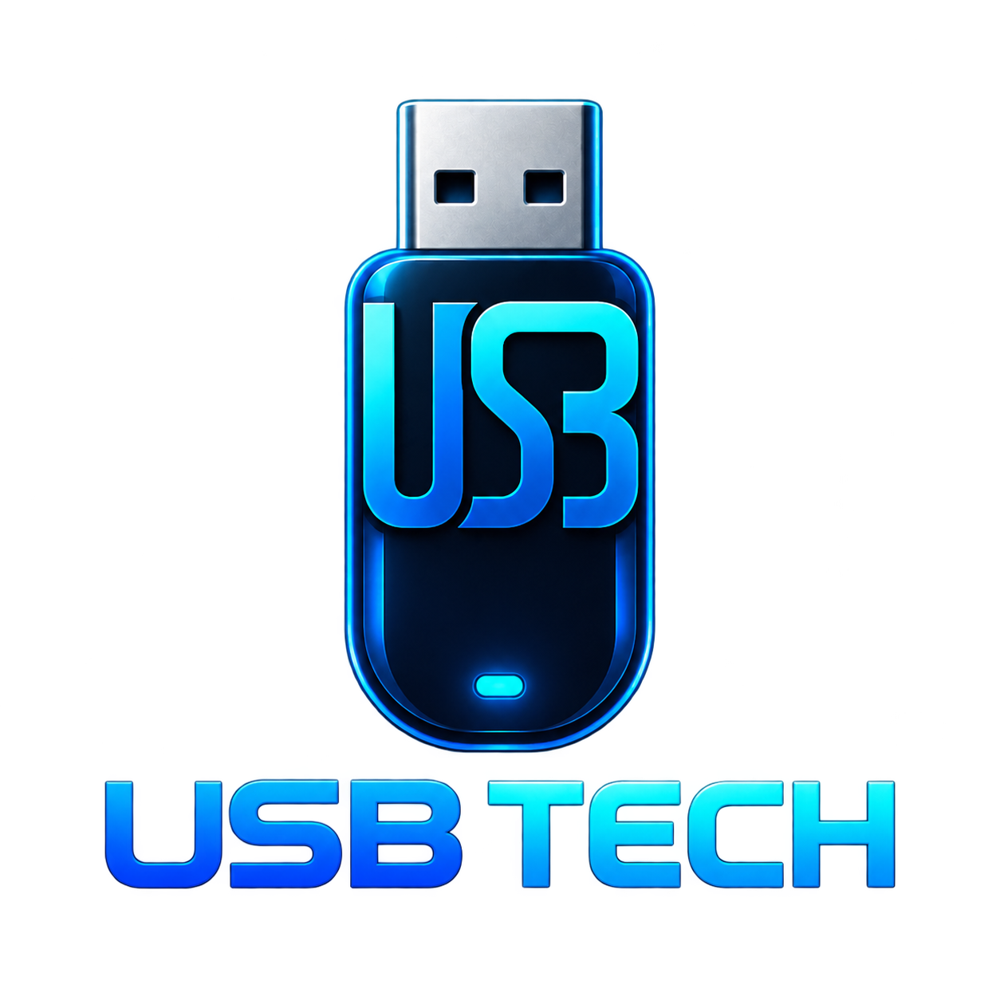

<h1 align="center">USB TECH · Digital Solutions</h1>

Company website & interactive experiences · موقع الشركة ونماذج تفاعلية

  <a href="https://usb-tech.ly/">Explore the live website</a> ·
  <a href="#interface-gallery--صور-الواجهات">View the interfaces</a> ·
  <a href="mailto:info@usb-tech.ly">Contact USB TECH</a>

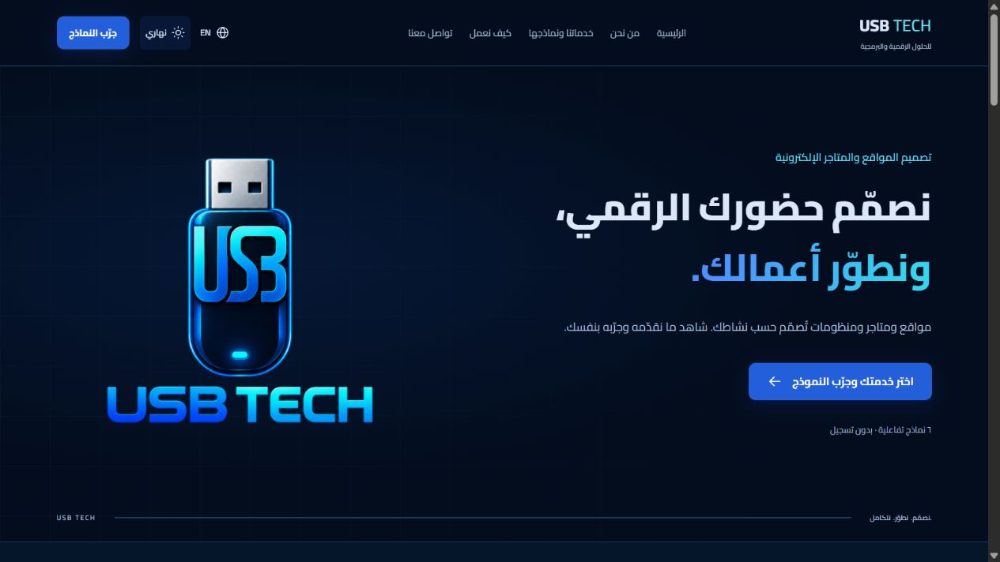

## About the project | عن المشروع

The official website of **USB TECH**, directed by **Omar H. Elabede**. It introduces the company's services through six interactive experiences, helping visitors explore a solution before starting a project conversation.

الموقع الرسمي لشركة **USB TECH** بإدارة **Omar H. Elabede**. يعرض خدمات تصميم المواقع والمتاجر الإلكترونية ومنظومات الأعمال من خلال نماذج يمكن تجربتها مباشرة، من رحلة العميل إلى إدارة العمليات.

The experience supports **Arabic and English**, **RTL and LTR**, and **light and dark themes**, with a focus on clear navigation and mobile usability.

## Six experiences | ستة نماذج

| Experience | What visitors can explore · ما يمكن تجربته |
| --- | --- |
| Business workflow · منظومة الأعمال | Create, review and approve a sample request; explore employee roles and an activity log. إنشاء المعاملة ومراجعتها واعتمادها مع أدوار الموظفين وسجل الإجراءات. |
| Company website · موقع الشركة | Brand presentation, services, project concepts and an enquiry journey. عرض الهوية والخدمات والمشاريع وطريقة التواصل. |
| Online store · المتجر الإلكتروني | Product catalogue, options, cart and a simulated checkout journey. كتالوج المنتجات والمواصفات والسلة وإتمام طلب تجريبي. |
| Sales assistant · مساعد المبيعات | Guided product selection, price and availability replies, and an order summary. عرض المنتجات والأسعار واختيار المواصفات وتجهيز ملخص الطلب. |
| Hotel · نظام الفندق | Guest booking and a staff workspace for reservations, rooms, arrivals and departures. حجز للضيف وإدارة الحجوزات والغرف والوصول والمغادرة للموظف. |
| Restaurant · نظام المطعم | Illustrated menu, customisation, cart, table bookings and kitchen order tracking. قائمة مصوّرة وتخصيص الأصناف والسلة وحجز الطاولات ومتابعة المطبخ. |

**Try it:** open [usb-tech.ly](https://usb-tech.ly/), choose a service, then select **«افتح النموذج»**. No registration is required for the demos.

## Interface gallery | صور الواجهات

Actual screenshots from the website. Select any image to view it at full size.

### Business workflow · منظومة الأعمال

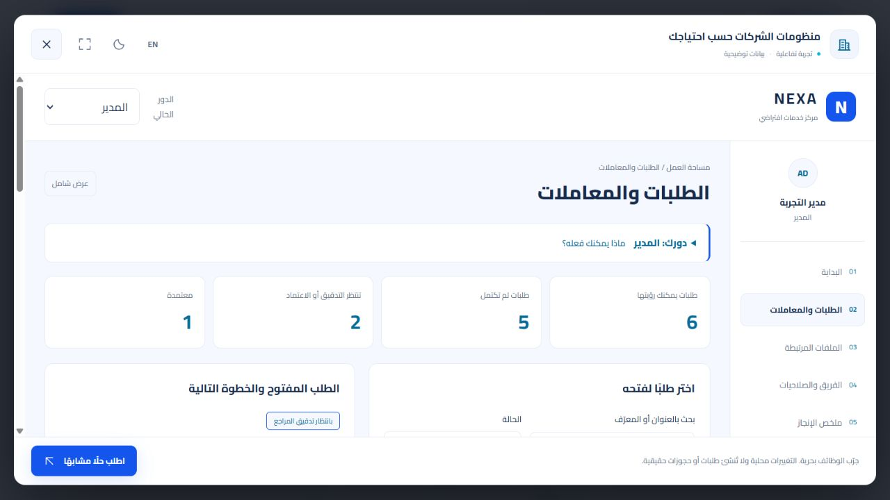

### Company website · الموقع التعريفي

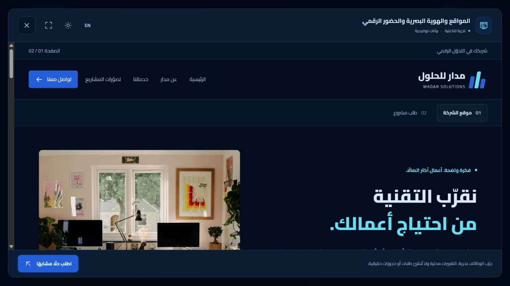

### Online store · المتجر الإلكتروني

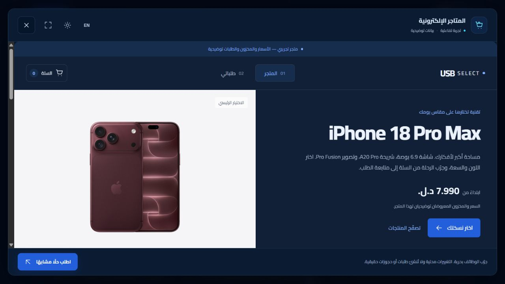

### Sales assistant · مساعد المبيعات

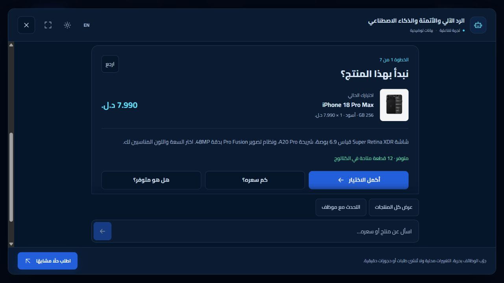

### Hotel · تجربة الضيف وإدارة الفندق

| Guest experience · الضيف | Management workspace · الموظف |
| --- | --- |
| 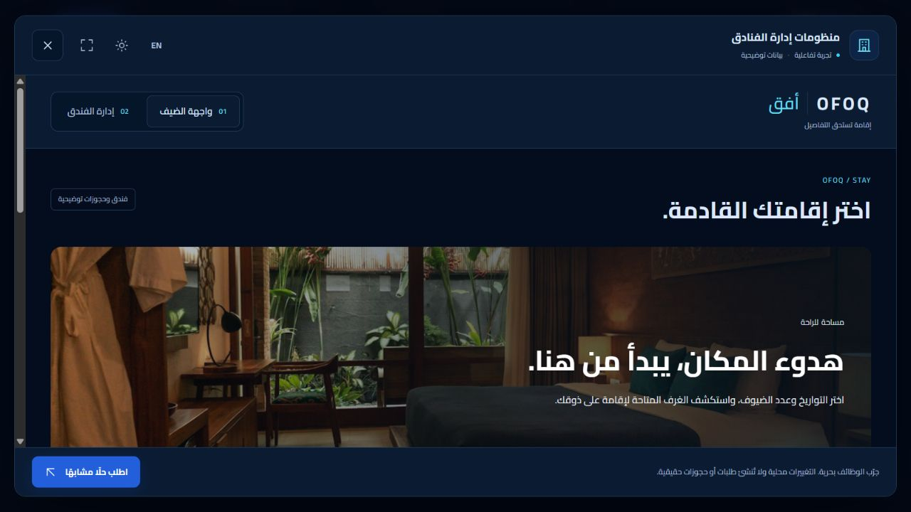 | 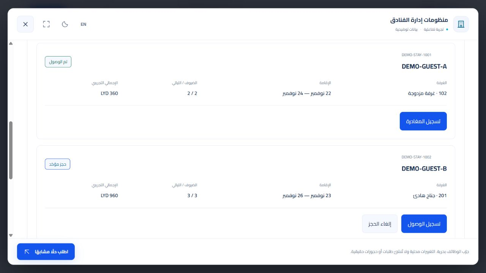 |

### Restaurant · تجربة العميل وإدارة المطعم

| Customer experience · العميل | Kitchen workspace · المطبخ |
| --- | --- |
| 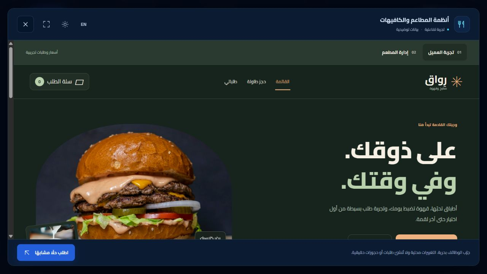 | 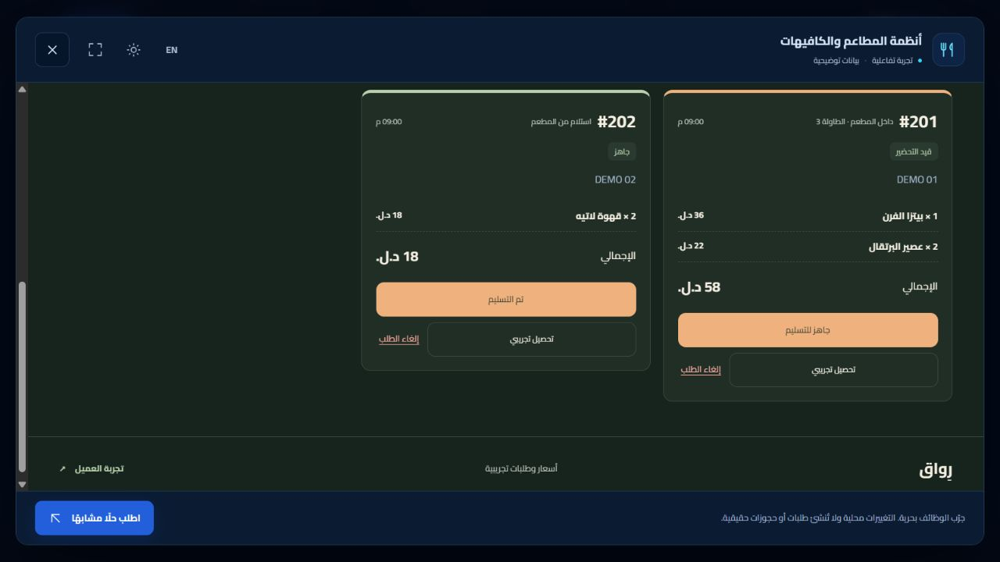 |

### Light theme · الوضع الفاتح

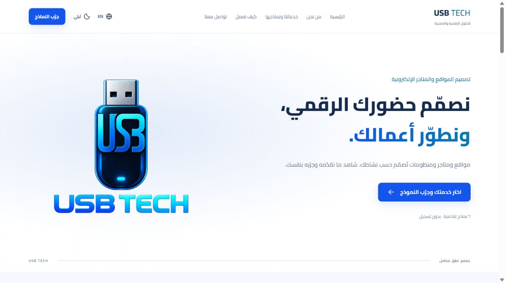

## Design & delivery | تجربة الاستخدام

- Bilingual interfaces with Arabic-first layouts and Cairo typography.
- Responsive navigation and touch-friendly controls.
- Six demos loaded on demand.
- Connected customer and staff journeys within the hotel and restaurant demos.
- Company enquiries submitted through the live website.

## Demo scope | طبيعة النماذج

The six demos use sample data and local session state. They illustrate interfaces and workflows; they do not create real purchases, bookings or payments. Employee roles are demonstrations, not production authentication. The sales assistant follows a guided, rule-based conversation.

النماذج تعرض تجربة الاستخدام ببيانات توضيحية، ولا تنشئ مشتريات أو حجوزات حقيقية. نموذج **«تواصل معنا» في الموقع الرسمي** هو وسيلة تواصل فعلية مع الشركة.

## Repository scope | محتوى المستودع

This is a **public project showcase** containing screenshots and documentation only. **Application source code, build files and server files are not included.** It is not an open-source software release.

هذا المستودع معرض عام لصور الواجهات وشرح المشروع فقط، ولا يتضمن السورس كود أو ملفات تشغيل الموقع أو الخادم.

**Company:** USB TECH · **Director:** [Omar H. Elabede](https://github.com/omarelabede)  
**Website:** [usb-tech.ly](https://usb-tech.ly/) · **Email:** [info@usb-tech.ly](mailto:info@usb-tech.ly)

© 2026 USB TECH. Screenshots are presented for portfolio viewing. Product names and third-party imagery remain the property of their respective owners.
